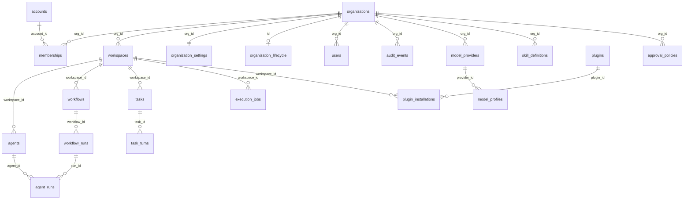
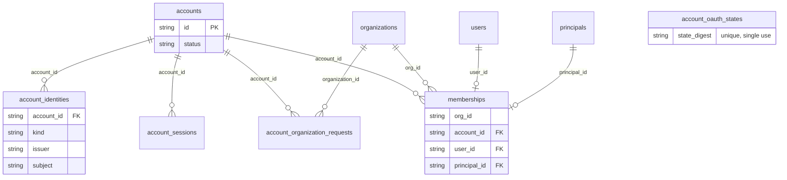
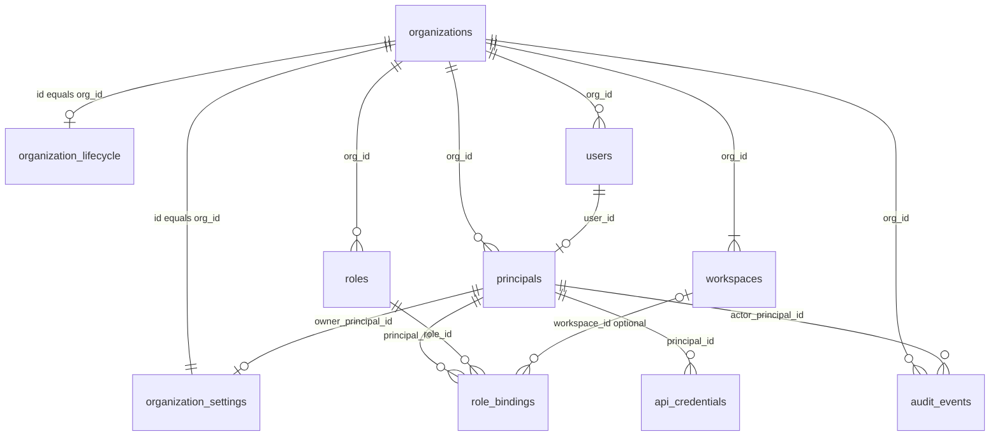
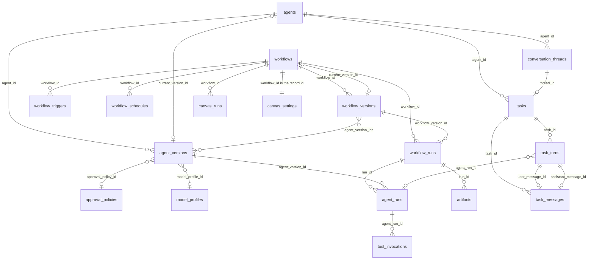
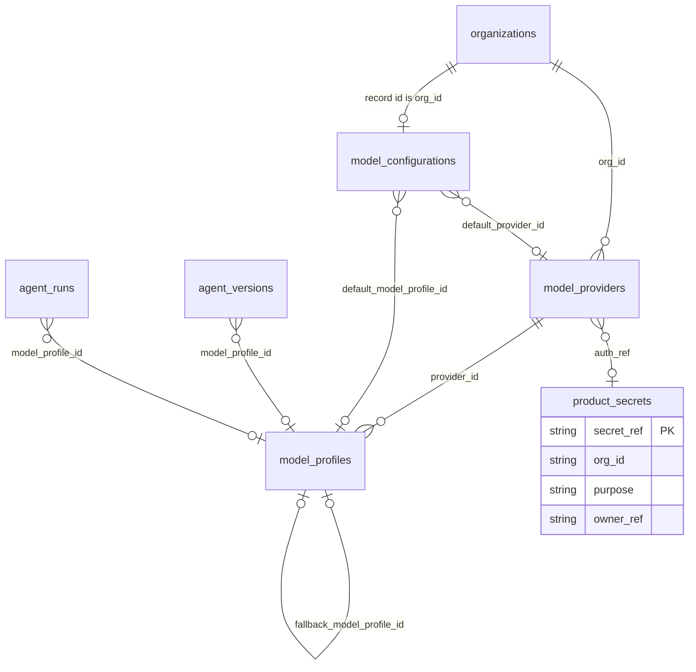
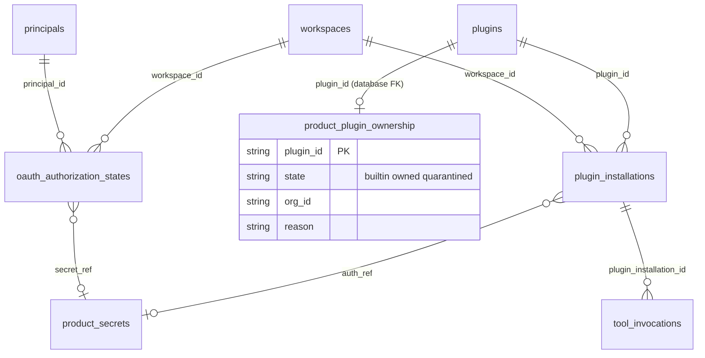
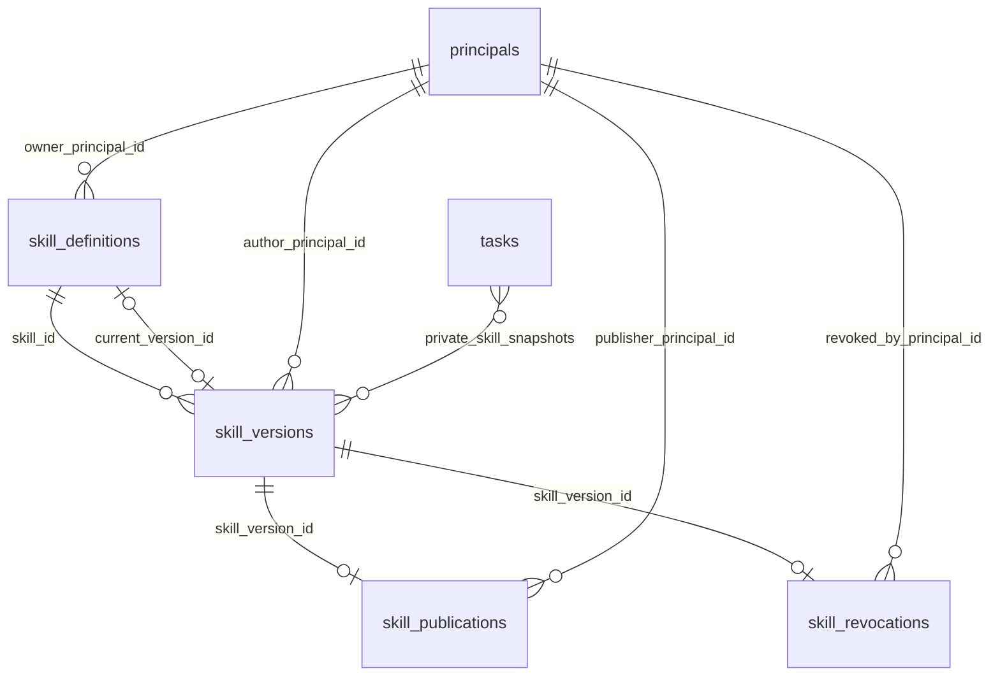
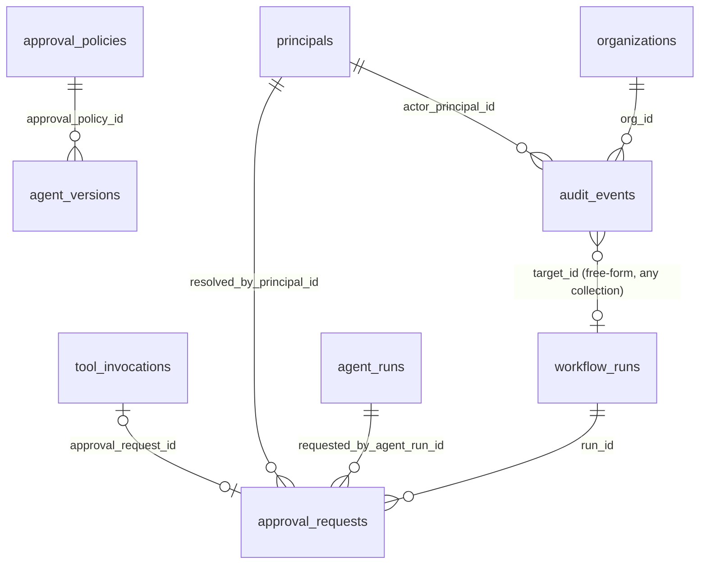
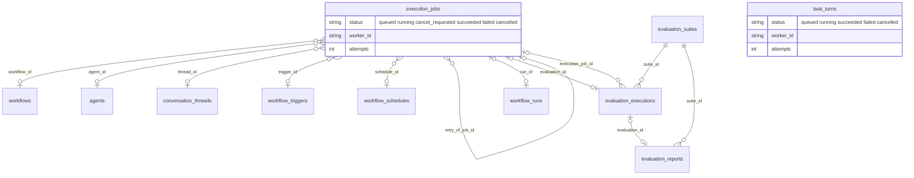

# ER diagrams

Logical relationships between collections of `product_records` (plus `product_secrets`
where a reference points at it). None of these is a database foreign key; they are
reference fields that the application resolves (see [../DATA_MODEL.md](../DATA_MODEL.md)
section 1.6). Entity names are collection names. The label on each line is the
referencing field. Cardinality notation: `||` exactly one, `o|` zero or one,
`o{` zero or many, `|{` one or many. The parent (left side) owns the lifetime of the
child, except where noted; deletion is by `PURGE_ORDER`, not by cascade.

Relationships come from the reference-like fields listed per collection in
[generated.md](generated.md).

## Overview

Every tenant collection also carries `org_id` to `organizations` (and workspace
collections `workspace_id` to `workspaces`); those edges are omitted from the domain
diagrams and drawn here once by domain.

## Identity and accounts

`accounts` is global. `memberships` is the only collection that carries both an account
and a tenant. `account_organization_requests` is a ledger and survives organization deletion.

`account_oauth_states` has no reference: it holds a Google sign-in attempt before any
account is known.

## Tenancy, access control and lifecycle

## Agents, workflows, tasks and runs

## Models and providers

## Integrations and plugins

`plugins` rows are either global built-ins (`github`, `slack`, `jira`, no `org_id`) or
owned by one organization. After migration 20 their ownership is the row in
`product_plugin_ownership` (a real foreign key to `product_records`).

## Skills

## Governance, approvals and audit

## Execution queue and evaluations

`task_turns` is the second durable queue (claimed the same way as `execution_jobs`) and
is related to `tasks` in the tasks diagram.
